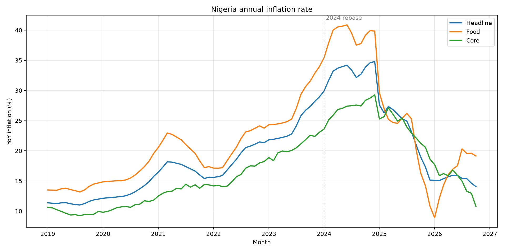
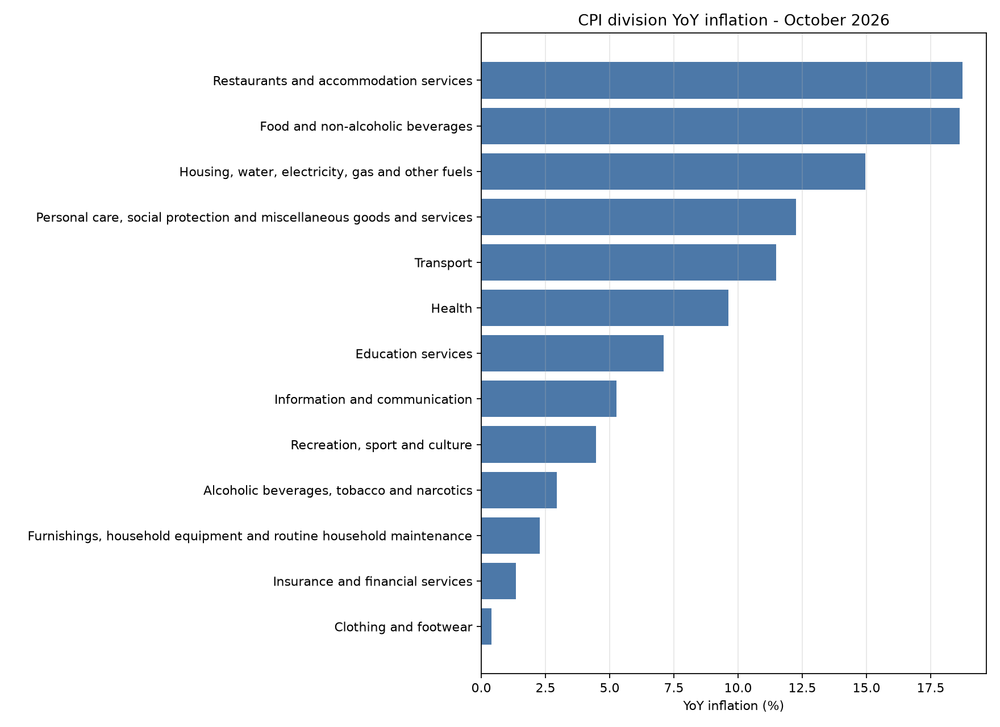
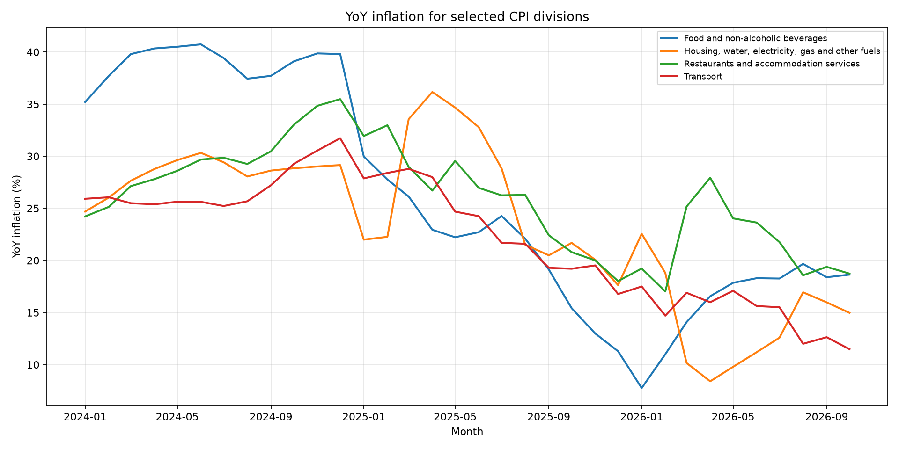
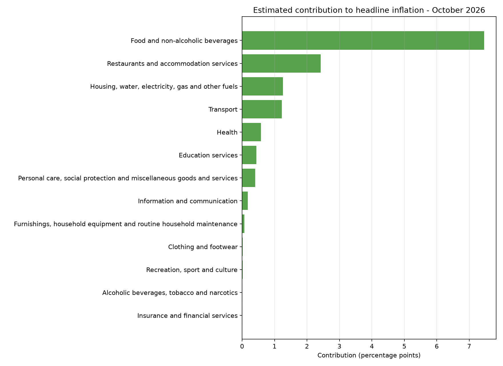

# Nigeria Inflation & Cost-of-Living Pulse

This repo tracks headline, food and core inflation in Nigeria and looks at which consumer categories have mattered most for cost-of-living pressure.

---

## Research question

How have headline, food and core inflation changed from 2019 to the latest available month, and which CPI categories have mattered most?

## Aim

To use monthly Consumer Price Index (CPI) data from the National Bureau of Statistics (NBS) to describe Nigeria's inflation trend and composition from 2019 to the latest available month, with attention to food and core inflation and the categories behind headline pressure.

## Objectives

1. Examine the historical trend of headline inflation and identify periods of acceleration, deceleration and significant changes.
2. Compare food inflation, core inflation and headline inflation.
3. Analyse month-on-month (MoM) and year-on-year (YoY) inflation.
4. Identify consumer price categories with the highest inflation rates and, where possible, the largest contributions to headline inflation.
5. Investigate inflationary changes around significant economic events without making unsupported causal claims.
6. Communicate findings using visualisations and a concise analytical memo.

---

## What was completed

- Inspected the NBS CPI source files and documented the coverage and handling rules in [`notes/dataset_inspection.md`](notes/dataset_inspection.md) and [`data/README.md`](data/README.md).
- Built an executed notebook plus two Python scripts to clean the data and regenerate the main outputs.
- Produced three processed datasets: a 94-month headline/food/core series, a 574-row CPI division panel, and a 130-row estimated contribution table.
- Calculated YoY and MoM inflation, food/core gaps, division-level inflation and weight-based contribution estimates.
- Kept the November 2009 and 2024 CPI bases separate so index levels were never mixed across the 2024 rebase.
- Generated five figures and an analytical memo covering the trend, category pressure, household interpretation and limitations.
- Validated the outputs: no duplicate or missing months, no duplicate category-months, no missing division index values, and an average absolute contribution gap of 0.03 percentage points.

## How the aim was met

| Aim component | Work done | Evidence |
|---|---|---|
| Describe Nigeria's inflation trend | Cleaned monthly headline, food and core inflation data from January 2019 to October 2026 and calculated YoY/MoM rates. | [`monthly_inflation.csv`](data/processed/monthly_inflation.csv), [`inflation_trends.png`](reports/figures/inflation_trends.png), [`memo.md`](reports/memo.md) |
| Compare headline, food and core inflation | Measured the average gap between food/core and headline inflation and summarised how the pattern changed. | [`memo.md`](reports/memo.md), [`inflation_trends.png`](reports/figures/inflation_trends.png) |
| Identify categories behind headline pressure | Cleaned the 13 CPI divisions and estimated contributions using NBS basket weights. | [`cpi_divisions.csv`](data/processed/cpi_divisions.csv), [`category_contributions.csv`](data/processed/category_contributions.csv), [`weighted_contribution_latest.png`](reports/figures/weighted_contribution_latest.png) |
| Handle the 2024 rebase carefully | Used rates across the base break but did not splice or compare raw index levels from different bases. | [`data/README.md`](data/README.md), [`memo.md`](reports/memo.md) |
| Communicate the findings | Provided an executed notebook, reproducible scripts, saved charts and a concise memo. | [`inflation_analysis.ipynb`](notebooks/inflation_analysis.ipynb), [`src/`](src/), [`reports/figures/`](reports/figures/), [`memo.md`](reports/memo.md) |

---

## Project structure

```text
nigeria-inflation-cost-of-living-pulse/
├── README.md
├── requirements.txt
├── .gitignore
├── data/
│   ├── README.md
│   ├── raw/                 # Unmodified NBS CPI source files, grouped by year
│   └── processed/           # Cleaned CSV datasets
├── notebooks/
│   └── inflation_analysis.ipynb
├── src/
│   ├── clean_cpi.py
│   └── generate_figures.py
├── reports/
│   ├── memo.md              # written interpretation
│   └── figures/             # generated charts
└── notes/
    └── dataset_inspection.md
```

## Data

Monthly CPI publications from Nigeria's National Bureau of Statistics (NBS), stored unmodified in `data/raw/` and grouped by year. See [`data/README.md`](data/README.md) for details, source attribution and handling rules.

## Setup

```powershell
py -3.14 -m venv .venv
.venv\Scripts\activate
pip install -r requirements.txt
```

The notebook contains the full walkthrough. The scripts run the same cleaning and figure-generation steps:

```powershell
py -3 src/clean_cpi.py
py -3 src/generate_figures.py
```

## Memo

Read the [analytical memo](reports/memo.md) for the interpretation of the cleaned CPI data.

## Dashboard

A static dashboard is available in [`docs/dashboard.html`](docs/dashboard.html). It is generated by [`src/build_dashboard.py`](src/build_dashboard.py) from the processed CSV files and saved figures.

## Visualisations



Headline inflation peaked at **34.80% in December 2024** and eased to **14.06% by October 2026**. Food averaged **2.57 percentage points above** headline across the period, while core averaged **2.53 percentage points below**.



In October 2026, restaurants and accommodation services had the highest YoY division rate at **18.73%**, followed by food and non-alcoholic beverages at **18.64%** and housing at **14.97%**.



The selected division trends show that food-related pressure stayed prominent through 2026, while several non-food categories eased from earlier highs.



Food and non-alcoholic beverages contributed **7.46 percentage points** in October 2026, ahead of restaurants and accommodation at **2.42 percentage points**. This shows why basket weights matter alongside inflation rates.


The weighted category contributions track headline inflation closely, with an average absolute gap of **0.03 percentage points**. That supports their use as an approximation rather than an official decomposition.

## Attribution and licence

Source: National Bureau of Statistics (NBS), Nigeria — CPI publications. Confirm the exact licence/attribution requirements from the NBS source pages and record them in `data/README.md`.
