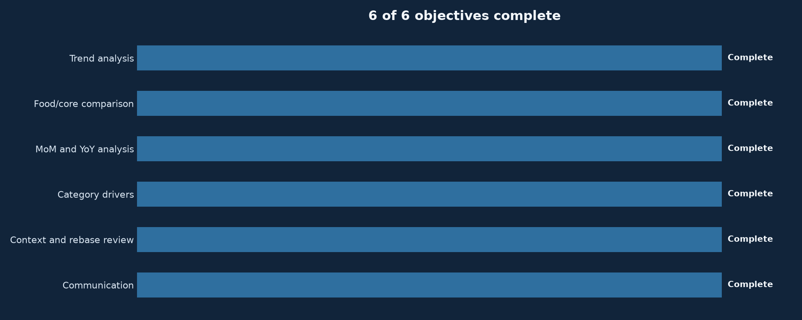
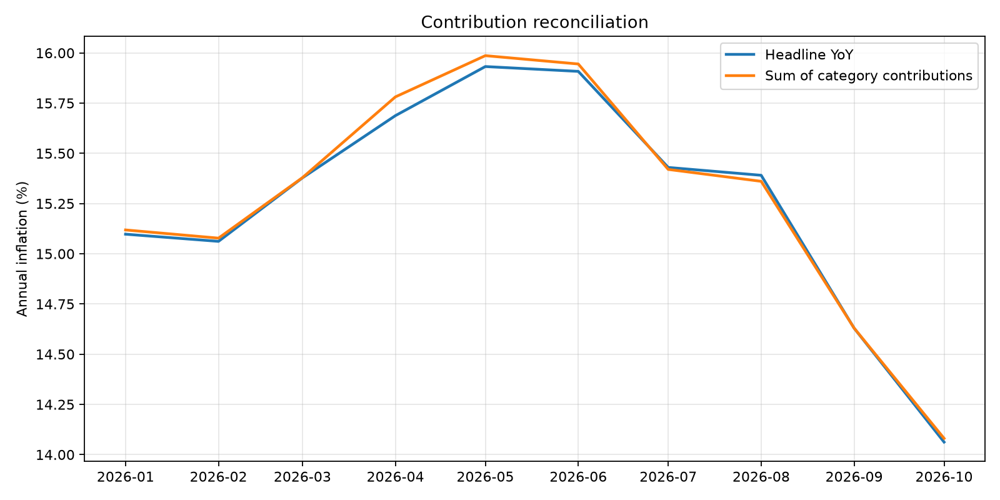

# Nigeria Inflation & Cost-of-Living Pulse

This repository analyses monthly Consumer Price Index (CPI) publications from Nigeria's National Bureau of Statistics (NBS). It examines how headline, food and core inflation evolved from January 2019 to October 2026, and which CPI divisions contributed most to recent headline pressure.

The project is designed as a reproducible portfolio analysis using Python for data cleaning and analysis, and HTML and CSS for the dashboard interface. The source workbooks are preserved, the full walkthrough is available in a notebook, and the findings are presented in a memo, charts and a web dashboard.

## Dashboard

A one-page dashboard summarises the latest headline, food and core inflation readings, the main category contributions and the supporting charts. It is published online for quick review.

[Open the live dashboard](https://blueeloop.github.io/Nigeria-Inflation-Cost-Of-Living-Pulse/dashboard.html)

## Tech stack

- Python: data cleaning, analysis, figure generation and dashboard assembly.
- HTML: dashboard structure and content layout in [`dashboard/index.html`](dashboard/index.html).
- CSS: dashboard theme, responsive layout and visual styling in [`dashboard/dashboard.css`](dashboard/dashboard.css).

---

## Project overview

### Problem statement

Monthly CPI releases provide detailed price data, but the headline rate alone does not show whether pressure is broad-based or concentrated in specific divisions. The 2024 rebasing also makes direct index-level comparisons across the full period invalid. This project addresses those issues by converting the source workbooks into a consistent analytical dataset, comparing headline, food and core inflation, and estimating category contributions without mixing CPI bases.

### Research question

How have headline, food and core inflation changed from 2019 to the latest available month, and which CPI categories have mattered most?

### Aim

To use monthly NBS CPI data to describe Nigeria's inflation trend and composition from 2019 to the latest available month, with particular attention to food and core inflation and the categories behind headline pressure.

### Objectives

1. Examine the historical trend of headline inflation and identify periods of acceleration, deceleration and significant changes.
2. Compare food inflation, core inflation and headline inflation.
3. Analyse month-on-month (MoM) and year-on-year (YoY) inflation.
4. Identify consumer price categories with the highest inflation rates and, where possible, the largest contributions to headline inflation.
5. Investigate inflationary changes around significant economic events without making unsupported causal claims.
6. Communicate the findings through visualisations, a concise analytical memo and a dashboard.

---

## Approach and deliverables

- Reviewed the supplied NBS CPI workbooks and documented coverage and handling rules in [`notes/dataset_inspection.md`](notes/dataset_inspection.md) and [`data/README.md`](data/README.md).
- Cleaned the source files using an executed notebook and reproducible Python scripts.
- Produced three processed datasets: a 94-month headline/food/core series, a 574-row CPI division panel, and a 130-row estimated contribution table.
- Calculated YoY and MoM inflation, food/core gaps, division-level inflation and weight-based contribution estimates.
- Kept the November 2009 and 2024 CPI bases separate so index levels were not mixed across the 2024 rebase.
- Generated five charts, an analytical memo and a one-page web dashboard.
- Validated the outputs: no duplicate or missing months, no duplicate category-months, no missing division index values, and an average absolute contribution gap of 0.03 percentage points.

## Alignment with the aim

| Aim component | Delivered work | Evidence |
|---|---|---|
| Describe Nigeria's inflation trend | Cleaned monthly headline, food and core inflation data from January 2019 to October 2026 and calculated YoY/MoM rates. | [`monthly_inflation.csv`](data/processed/monthly_inflation.csv), [`inflation_trends.png`](reports/figures/inflation_trends.png), [`memo.md`](reports/memo.md) |
| Compare headline, food and core inflation | Measured the average gap between food/core and headline inflation and summarised how the pattern changed. | [`memo.md`](reports/memo.md), [`inflation_trends.png`](reports/figures/inflation_trends.png) |
| Identify categories behind headline pressure | Cleaned the 13 CPI divisions and estimated contributions using NBS basket weights. | [`cpi_divisions.csv`](data/processed/cpi_divisions.csv), [`category_contributions.csv`](data/processed/category_contributions.csv), [`weighted_contribution_latest.png`](reports/figures/weighted_contribution_latest.png) |
| Handle the 2024 rebase carefully | Used rates across the base break but did not splice or compare raw index levels from different bases. | [`data/README.md`](data/README.md), [`memo.md`](reports/memo.md) |
| Communicate the findings | Provided an executed notebook, reproducible scripts, saved charts, a memo and a dashboard. | [`inflation_analysis.ipynb`](notebooks/inflation_analysis.ipynb), [`src/`](src/), [`reports/figures/`](reports/figures/), [`memo.md`](reports/memo.md) |

## Objectives at a glance

The chart below summarises delivery against the six objectives introduced above. The supporting work and evidence are listed in [Alignment with the aim](#alignment-with-the-aim).



---

## Data and method

Monthly CPI publications from Nigeria's National Bureau of Statistics are stored unmodified in `data/raw/`, grouped by year. See [`data/README.md`](data/README.md) for dataset definitions, cleaning decisions and handling rules.

The CPI was rebased in 2024. This analysis uses inflation rates across the break while keeping index levels within their original base, so the two regimes are not spliced or directly compared. Estimated contributions combine each division's YoY rate with its CPI basket weight; they are intended as an analytical approximation, not an official decomposition.

---

## Dashboard details

The dashboard presents the latest CPI indicators, category drivers and supporting charts in a compact view. It is intended for readers who want the main results without first opening the notebook or memo.

- [Open the published dashboard](https://blueeloop.github.io/Nigeria-Inflation-Cost-Of-Living-Pulse/dashboard.html)
- [Open the dashboard page in the repository](docs/dashboard.html)

---

## Key findings

- Headline inflation peaked at **34.80% in December 2024** and eased to **14.06% by October 2026**.
- Food inflation averaged **2.57 percentage points above** headline across the period, while core inflation averaged **2.53 percentage points below** headline.
- In October 2026, food and non-alcoholic beverages contributed **7.46 percentage points**, or about 53% of the headline rate.
- The weighted category contributions track headline inflation closely, with an average absolute gap of **0.03 percentage points**.
- The 2024 rebasing changed the basket and weights, but the analysis avoids comparing index levels from different bases.

---

## Repository structure

```text
Nigeria-Inflation-Cost-Of-Living-Pulse/
├── README.md
├── requirements.txt
├── .gitattributes
├── .gitignore
├── data/
│   ├── README.md
│   ├── raw/
│   │   ├── CPI 2019/
│   │   ├── CPI 2020/
│   │   ├── CPI 2021/
│   │   ├── CPI 2022/
│   │   ├── CPI 2023/
│   │   ├── CPI 2024/
│   │   ├── CPI 2025/
│   │   └── CPI 2026/
│   └── processed/
│       ├── monthly_inflation.csv
│       ├── cpi_divisions.csv
│       └── category_contributions.csv
├── dashboard/
│   ├── index.html                      # Dashboard page source
│   ├── dashboard.css                   # Dashboard theme and layout
│   └── *.png                           # Charts used by the dashboard
├── docs/
│   ├── dashboard.html                  # Published dashboard page
│   ├── dashboard.css                   # Dashboard theme and layout
│   ├── index.html                      # Dashboard landing page
│   └── *.png
├── notebooks/
│   └── inflation_analysis.ipynb
├── src/
│   ├── clean_cpi.py
│   ├── generate_figures.py
│   └── build_dashboard.py
├── reports/
│   ├── memo.md
│   └── figures/
│       ├── objectives_achieved.png
│       ├── inflation_trends.png
│       ├── category_yoy_latest.png
│       ├── key_category_trends.png
│       ├── weighted_contribution_latest.png
│       └── contribution_reconciliation.png
└── notes/
    ├── concepts.md
    └── dataset_inspection.md
```

---

## Reproducing the analysis

```powershell
py -3 -m venv .venv
.venv\Scripts\activate
pip install -r requirements.txt
```

The notebook contains the full walkthrough. The scripts run the same cleaning, figure-generation and dashboard-building steps:

```powershell
py -3 src/clean_cpi.py
py -3 src/generate_figures.py
py -3 src/build_dashboard.py
```

---

## Memo and visualisations

Read the [analytical memo](reports/memo.md) for the full interpretation of the cleaned CPI data.


Headline inflation peaked at **34.80% in December 2024** and eased to **14.06% by October 2026**. Food averaged **2.57 percentage points above** headline across the period, while core averaged **2.53 percentage points below**.


In October 2026, restaurants and accommodation services had the highest YoY division rate at **18.73%**, followed by food and non-alcoholic beverages at **18.64%** and housing at **14.97%**.


The selected division trends show that food-related pressure stayed prominent through 2026, while several non-food categories eased from earlier highs.


Food and non-alcoholic beverages contributed **7.46 percentage points** in October 2026, ahead of restaurants and accommodation at **2.42 percentage points**. This shows why basket weights matter alongside inflation rates.



The weighted category contributions track headline inflation closely, with an average absolute gap of **0.03 percentage points**. That supports their use as an approximation rather than an official decomposition.

---

## Attribution and licence

Source: National Bureau of Statistics (NBS), Nigeria — CPI publications. Confirm the exact licence and attribution requirements from the NBS source pages and record them in [`data/README.md`](data/README.md).
